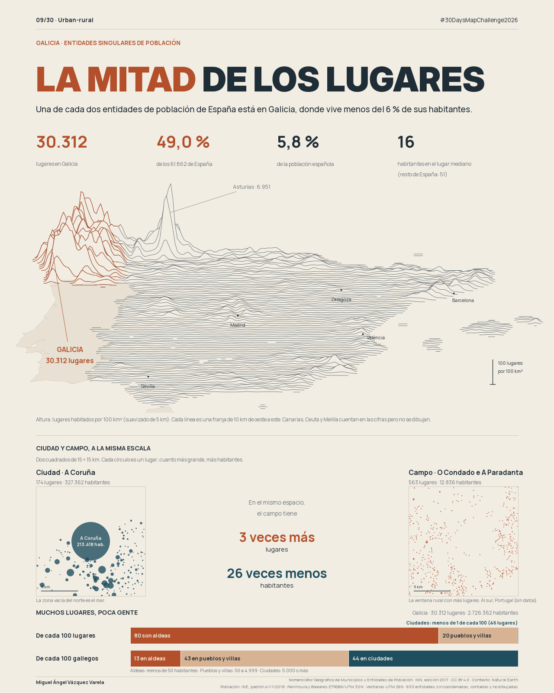

# Día 09 · Urban-rural

# Galicia, la mitad de los lugares

**Una de cada dos entidades de población de España está en Galicia, donde vive
menos del 6 % de sus habitantes.**

Estado: **aprobado por el autor el 11/11/2026**. Queda pendiente contrastar las
cifras con la edición vigente del NGMEP.



- [JPG para LinkedIn](09-urban-rural-linkedin.jpg) · [texto del post](post-linkedin.md)
- [SVG](09-urban-rural-map.svg)

## Tema y lectura

Tema oficial: «Urban or rural. Cities and countryside». Nuestra interpretación
compara el número de **lugares habitados** con el número de **habitantes**. Galicia
reúne 30.312 de las 61.862 entidades singulares de población de España (49,0 %)
y el 5,8 % de su población. El lugar gallego mediano tiene 16 habitantes; en el
resto de España, 51.

La lámina tiene tres lecturas:

1. **Relieve de lugares.** Vista oblicua de la península y Baleares. Cada línea
   es una franja de 10 km de oeste a este; su altura indica cuántos lugares
   habitados hay por cada 100 km², con un suavizado gaussiano de 5 km sobre una
   malla de 5 km. Galicia, en teja, se levanta como una cordillera. El pico
   cantábrico de Asturias (6.951 lugares) se rotula para que se vea que la
   dispersión también es cantábrica. Canarias, Ceuta y Melilla cuentan en las
   cifras, pero no se dibujan.
2. **Ciudad y campo a la misma escala.** Dos ventanas de 15 × 15 km en UTM 29N.
   El área de cada círculo es proporcional a sus habitantes. A Coruña: 174 lugares
   y 327.362 habitantes. O Condado e A Paradanta: 563 lugares y 12.836 habitantes,
   con una mediana de 13. Es decir, 3,2 veces más lugares y 26 veces menos gente.
3. **«Muchos lugares, poca gente».** Dos barras con los lugares gallegos
   agrupados en aldeas (menos de 50 habitantes), pueblos y villas (50–4.999) y
   ciudades (5.000 o más). De cada 100 lugares, 80 son aldeas, 20 pueblos y villas
   y menos de 1 ciudad (46 lugares). De cada 100 gallegos, 13 viven en aldeas,
   43 en pueblos y villas y 44 en ciudades. Las seis clases detalladas están en
   `output/summary.json`.

## Fuente

**Nomenclátor Geográfico de Municipios y Entidades de Población (NGMEP)**, IGN–CNIG,
edición 2017 (memoria `Memoria_NGMEP_2017.pdf`). Datos del IGN bajo CC BY 4.0.
La población procede del INE: la suma municipal (46.557.008) coincide con el padrón
a 1 de enero de 2016. Coordenadas ETRS89 geográficas, REGCAN95 en Canarias.

**Procedencia de la copia.** El entorno de trabajo no tenía acceso al Centro de
Descargas del CNIG. Se usó una copia sin modificar del archivo oficial (`.mdb` y
memoria) alojada en
[perezp44/spanishRentidadesIGN](https://github.com/perezp44/spanishRentidadesIGN),
commit `0686da61`, del 09/02/2018. Los SHA-256 constan en el manifiesto.
**Pendiente:** contrastar con la edición vigente del CNIG
(`BD_Municipios-Entidades.zip`, serie NGMEN). Al actualizar cambiarán la población
y algunas entidades. La estructura dispersa del poblamiento gallego no depende de
la edición, pero las cifras exactas sí.

**Contexto gráfico:** Natural Earth 1:10m (dominio público), solo para dibujar
Portugal, Marruecos y Andorra en el relieve y para estimar la parte portuguesa
de la ventana rural (≈12 %). Su escala es demasiado general para dibujar costa o
frontera en las ventanas de 15 km, así que allí no se representan.
Procedencia en `data/processed/day-09-urban-rural/context-naturalearth.json`.

## Método

- `prepare_sources.py` lee la tabla `ENTIDADES` de la base Access, conserva las
  filas `TIPO = Entidad singular` y los municipios, y escribe
  `data/processed/day-09-urban-rural/*.csv` con su manifiesto.
- **Entidad singular** es la unidad del INE: un lugar habitado con nombre propio.
  Su población incluye sus núcleos y su diseminado. No equivale a un núcleo
  urbano, una parroquia ni un municipio.
- **Sin coordenadas:** 930 entidades en España, 307 de ellas en Galicia, figuran
  en (0, 0). Se cuentan en todas las cifras y no se dibujan; no se les asigna
  posición. Las entidades con origen de coordenada «No disponible» y coordenadas
  válidas se dibujan tal como vienen.
- Se conservan las entidades marcadas como suprimidas en cartografía (76 en Galicia)
  o discrepantes con el INE (186). Siguen en el nomenclátor de esa edición.
- **Denominadores.** El porcentaje de población usa la población municipal. Las
  clases de tamaño usan la suma de las entidades gallegas (2.726.362). En 19
  municipios gallegos esa suma difiere de la municipal (+7.837 en total, el 0,29 %),
  y se registra en el manifiesto.
- **Ventana rural:** de entre las ventanas de 15 km que se obtienen desplazándose
  en pasos de 1 km, la que tiene más lugares, siempre que ninguna entidad alcance
  1.000 habitantes y que las 9 subceldas de 5 km tengan algún lugar. Esta última
  condición evita ventanas medio vacías por costa o frontera. La seleccionan los
  datos, no una elección visual. Municipios: As Neves, Arbo, A Cañiza,
  Salvaterra de Miño, Ponteareas, Covelo y Mondariz.
- **Ventana urbana:** centrada en la entidad A Coruña (`15030000100`). El vacío
  del norte es mar.
- **Relieve:** malla de 5 km en UTM 30N; suavizado gaussiano de σ = 5 km
  (implementado con NumPy); una línea cada 10 km; inclinación vertical 0,42;
  560 m de altura gráfica por lugar/100 km². Se tiñe de teja el tramo donde más
  de la mitad de la densidad suavizada procede de entidades gallegas.
- Proyecciones: península y Baleares en ETRS89 / UTM 30N (EPSG:25830); Canarias en
  recuadro con WGS 84 / UTM 28N (EPSG:32628) y escala propia; ventanas en UTM 29N
  (EPSG:25829). Ceuta y Melilla (4 entidades) se cuentan y no se dibujan.

## Límites

- Contar lugares no mide calidad de vida, despoblación ni abandono: una entidad
  con 0 habitantes puede seguir existiendo como topónimo.
- La definición de entidad singular la aplican los ayuntamientos y el INE con
  criterios históricos distintos por territorio. Parte de la diferencia entre
  Galicia y el resto de España es administrativa, no solo física.
- Los puntos son centroides de cada lugar. El relieve muestra densidad de lugares,
  no superficie edificada ni población; el suavizado redondea los bordes y
  prolonga algo la densidad sobre el mar en la costa.
- La edición de 2017 tiene datos de población de 2016 (ver *Pendiente*).

## Diseño

Fondo lino, tinta azul pizarra y un rojo teja para Galicia. Dos familias de
palo seco: Inter Display Black en mayúsculas para el título, con «La mitad» en
teja, y Manrope para el subtítulo, las cifras y el texto. La cabecera y el pie
son los comunes a la colección. Manrope se instancia en pesos estáticos (400, 500
y 700) a partir de la fuente variable (OFL), porque Matplotlib no gestiona ejes
variables. Licencias en `fonts/`.

## Reproducir

```sh
uv run --frozen --with access-parser python days/day-09-urban-rural/prepare_sources.py
uv run --frozen python days/day-09-urban-rural/main.py
uv run --frozen python -m pytest -q tests/test_day09_urban_rural.py
```

El `.mdb` original no se versiona (29 MB). Para regenerar, colocarlo en
`data/raw/day-09-urban-rural/` y comprobar su SHA-256 con el manifiesto.
